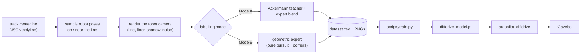

# diffdrivebot

**Camera-only line following for a differential-drive robot, trained entirely in simulation.**

[](https://docs.ros.org/en/jazzy/)
[](https://gazebosim.org/)
[](https://pytorch.org/)
[](https://www.python.org/)
[](LICENSE)
[](https://github.com/stealth-exe/diffdrivebot/releases/latest)

A small CNN looks at a **128 × 96 grayscale camera image** and outputs a forward speed and a turn rate. A differential-drive
robot in Gazebo uses those commands to follow a black line on a white floor, including 90° corners.

The interesting part is where the training data comes from: the tracks are known polylines, so every camera image can be
**rendered synthetically** and labelled automatically. No manual driving, no hand-labelled frames and no real robot are needed.

---

## Highlights

- **End-to-end policy** — raw pixels in, `/cmd_vel` out; no separate line detector at inference time.
- **Synthetic supervision** — render the robot's camera from sampled poses on a known centerline, then label each pose.
- **Two labelling modes** — distill an existing Ackermann autopilot (*Mode A*) or use a geometric expert controller (*Mode B*).
- **Corner-aware expert** — look-ahead control with a corner turn-in and slowdown profile, so sharp corners do not get cut.
- **Lost-line reflex** — if the line leaves the camera view, the robot rotates in place to find it again.
- **Reproducible container** — ROS 2 Jazzy, Gazebo Harmonic, a CPU PyTorch environment and a browser-accessible desktop in Docker.

---

## Contents

1. [Quick start](#quick-start)
2. [Everyday workflow](#everyday-workflow)
3. [Training your own model](#training-your-own-model)
4. [How it works](#how-it-works)
5. [Configuration](#configuration)
6. [Repository layout](#repository-layout)
7. [Tool reference](#tool-reference)
8. [Troubleshooting](#troubleshooting)
9. [Credits and license](#credits-and-license)

---

## Quick start

### What you need

- An Apple-silicon Mac with [OrbStack](https://orbstack.dev/) or Docker Desktop.
- About 10 GB of free disk space for the images and the ROS workspace.
- A trained checkpoint (`diffdrive_model.pt`), available from the
  [Releases page](https://github.com/stealth-exe/diffdrivebot/releases/latest), or trained by you with the steps below.

Everything runs on the CPU. Gazebo is software-rendered, so the simulation runs below real time; that is expected.

### 1. Clone and download the weights

```bash
git clone https://github.com/stealth-exe/diffdrivebot.git
cd diffdrivebot

# Model weights are distributed as a GitHub Release asset, not committed to git.
curl -L -o diffdrive_model.pt \
  https://github.com/stealth-exe/diffdrivebot/releases/latest/download/diffdrive_model.pt
```

### 2. Build the Docker images

The first image installs ROS 2 Jazzy, Gazebo Harmonic and the Python environment. The second adds a lightweight VNC desktop.

```bash
docker build --platform linux/arm64 -f docker/Dockerfile.arm -t diffdrivebot:harmonic .
docker build --platform linux/arm64 -f docker/Dockerfile.mac -t diffdrivebot:harmonic-mac .
```

### 3. Start the container

```bash
bash docker/run_docker_mac.sh
```

The script creates a container named `line_follower` the first time and attaches to it on later runs. It mounts this
checkout at `/tmp/diffdrivebot` (`$REPO`) and publishes the web desktop on **port 6767**.

Inside the container:

```bash
start_desktop.sh                 # start Xvfb + x11vnc + websockify; once per container start
export DISPLAY=:1                # in every terminal that opens a GUI
mkdir -p "$DATA"                 # dataset directory on the container's disk
```

Open <http://localhost:6767/vnc.html> in a browser. The Gazebo window will appear there. `start_desktop.sh` prints the
same URL; **6080 is only the container-internal websockify port**, while **6767** is the port published on the Mac.

### 4. Drive

```bash
source /opt/ros/jazzy/setup.bash
source ~/workspace/install/setup.bash

# Spawn in the middle of the first side of the track, pointing along it.
read X Y YAW < <(python3 "$PKG/distill/start_pose.py" "$REPO/tracks/loop0_points.json")

ros2 launch diffdrivebot diffdrive_sim.launch.py \
  world:="$REPO/worlds/loop0.sdf" x:="$X" y:="$Y" yaw:="$YAW"
```

The launch file starts Gazebo, spawns the robot, bridges the ROS ↔ Gazebo topics and runs the autopilot node. The same
command works for the other worlds — replace `loop0` with `hexagon`, `circle_2_5` or `final_grading`.

| Launch argument | Default | Meaning |
|---|---|---|
| `world` | `empty.sdf` | SDF world to load |
| `x`, `y`, `yaw` | `0.0` | Spawn pose of the axle centre `[m, rad]` |
| `z` | `0.06` | Spawn height; the robot drops onto the floor |
| `autopilot` | `true` | Set to `false` to spawn the robot without the neural autopilot |

Useful extras:

```bash
# Drive manually (the robot's DiffDrive plugin listens on /cmd_vel).
ros2 topic pub -r 10 /cmd_vel geometry_msgs/msg/Twist \
  "{linear: {x: 0.2}, angular: {z: 0.0}}"

# Save one camera frame to look at what the network sees.
python3 "$PKG/distill/grab_frame.py"

# Stop a leftover simulation before the next run (a stale Gazebo keeps the old robot pose).
pkill -f "gz sim"; pkill -f parameter_bridge; pkill -f autopilot_diffdrive
pkill -f robot_state_publisher; sleep 3
```

Bridged topics: `/cmd_vel` (ROS → Gazebo), `/camera/image_raw`, `/odom` and `/joint_states` (Gazebo → ROS).

---

## Everyday workflow

The image already contains a built copy of the package at `~/workspace/src/diffdrivebot` (`$PKG`). The host checkout is
mounted separately at `/tmp/diffdrivebot` (`$REPO`), so your edits and model files survive container rebuilds.

After changing code or configuration on the Mac, sync the package into the workspace and rebuild:

```bash
mkdir -p "$PKG"
tar -C "$REPO" --exclude=.git --exclude='*.pt' --exclude='dataset_*' -cf - . | tar -C "$PKG" -xf -

cd ~/workspace
source /opt/ros/jazzy/setup.bash
source ~/.venv/bin/activate
colcon build --packages-select diffdrivebot
source install/setup.bash
```

Rebuild after editing `config/*.yaml`, `launch/*.py`, `urdf/*` or any Python source. `worlds/`, `tracks/` and `meshes/` are
read directly from `$REPO`, so they do not need a rebuild.

> **Keep the container.** `docker run` options only apply when a container is created. Removing `line_follower` also deletes
> the built workspace and datasets that live on the container disk. The mounted repository is safe.

---

## Training your own model

Pipeline: **tracks → synthetic dataset → train → evaluate → deploy**. Only the labelling step differs between modes.



### The two supervision modes

| | **Mode A — teacher distillation** | **Mode B — expert labels** |
|---|---|---|
| Idea | Distil an existing Ackermann (car) autopilot onto the new robot | Label every pose with a geometric look-ahead controller that knows the centerline |
| Teacher checkpoint | Required | Not required |
| Flag | `--mode hybrid` (default) or `--mode teacher` | `--mode expert` |
| Strength | Transfers the behaviour of a model you already have | Tight tracking, especially at sharp corners; no teacher dependency |
| Weakness | The teacher was trained on roads and cannot take 90° corners; pure teacher labels lose the line there, so `hybrid` hands over to the expert | Imitates a controller rather than a learned policy |

Both modes share the robot, renderer, dataset format, training script and ROS node.

### 1. Tracks (centerlines)

`tracks/` already contains the centerlines of the four included worlds and their mirror images, so you can skip this step.
To regenerate them or add a world:

```bash
cd "$PKG/distill"

# Worlds built from thin strips / rings.
python3 sdf_to_track.py "$REPO/worlds/hexagon.sdf"    -o "$REPO/tracks/hexagon_points.json"    --png "$REPO/hexagon_check.png"
python3 sdf_to_track.py "$REPO/worlds/circle_2_5.sdf" -o "$REPO/tracks/circle_2_5_points.json"
python3 sdf_to_track.py "$REPO/worlds/loop0.sdf"      -o "$REPO/tracks/loop0_points.json"

# A world whose track is an STL mesh.
python3 stl_to_track.py "$REPO/worlds/final_grading.sdf" --stl "$REPO/meshes/final_grading.stl" \
  -o "$REPO/tracks/final_grading_points.json" --png "$REPO/final_grading_check.png"

# Mirror every track: each left turn becomes a right turn.
python3 mirror_track.py $(ls "$REPO"/tracks/*_points.json | grep -v _mirror_)
```

Always open the `--png` check image: the red centerline must run along the middle of the black line. Each JSON stores the
points, whether the track is closed, the line width and the floor rectangle.

> **Why mirror images?** A counter-clockwise track only contains left turns. Training on tracks that go one way makes the
> student weaker at the other turn direction, so every track is used together with its mirror image.

### 2. Generate a synthetic dataset

`make_distill_dataset.py` samples robot poses on the tracks (on the line, offset, rotated, on the approach to corners),
renders what the robot's camera would see (dark line on a light floor, the robot's own shadow, brightness/noise/blur/camera
jitter) and writes the images plus labels in the format `train.py` reads:

- `dataset.csv` — `image_id, velocity, steering_angle, max_velocity, max_steering_angle` plus debugging columns
  (`steering_angle` holds the angular velocity ω in rad/s)
- `distill_meta.json` — the exact parameters and output limits used for the dataset
- `preview.png` — a labelled montage of sample images

List each track several times. Every listed entry becomes a separate job, which keeps each worker's memory small:

```bash
cd "$PKG/distill"
export OMP_NUM_THREADS=1

TRACKS=""
for f in "$REPO"/tracks/*_points.json; do
  for i in 1 2 3 4; do TRACKS="$TRACKS $f"; done
done
```

#### Mode B — expert labels (recommended, no teacher)

```bash
# Optional: check the label policy in a kinematic simulation before rendering 40k images.
python3 rollout_check.py --mode expert --track "$REPO/tracks/loop0_points.json" --random 3

python3 make_distill_dataset.py \
  --out "$DATA/dataset_expert" \
  --num-samples 40000 \
  --track $TRACKS \
  --random-tracks 40 \
  --mode expert \
  --workers 2
```

#### Mode A — teacher distillation

This needs an Ackermann teacher checkpoint at `$REPO/model.pt`, produced by the original Ackermann pipeline
(`data_collector` + `scripts/train.py`). It is not included in this repository.

```bash
# Optional: check the teacher on synthetic road renders and calibrate road width / steering sign.
python3 probe_teacher.py --teacher "$REPO/model.pt"

# Optional: closed-loop test of the blended labels.
python3 rollout_check.py --teacher "$REPO/model.pt" \
  --track "$REPO/tracks/loop0_points.json" --mode hybrid --random 3

python3 make_distill_dataset.py \
  --teacher "$REPO/model.pt" \
  --out "$DATA/dataset_teacher" \
  --num-samples 40000 \
  --track $TRACKS \
  --random-tracks 40 \
  --mode hybrid \
  --workers 2
```

For every pose the tool:

1. renders the centerline as a *road* seen by a virtual copy of the teacher's camera and asks the teacher for
   `(speed, steering)`;
2. converts the steering to a curvature and then to an angular velocity for the robot;
3. computes the expert label;
4. blends the two by the look-ahead heading error — teacher below `--a0` (20°), expert above `--a1` (50°), smooth in
   between;
5. renders the robot's own view and stores it with the blended label.

`--mode teacher` uses the teacher only. It loses the line at sharp corners, which is why `hybrid` is the default.
Related options: `--a0 --a1 --scale --road-width --steer-sign --no-symmetrize --backend {auto,torch,numpy}`.

#### After either mode

Look at `$DATA/<dataset>/preview.png` and the printed statistics. At the start the tool reports
`robot body hides 0.0 % of the camera image`; a non-zero value means the chassis is visible and should be fixed in the URDF.
At the end it prints the limits that **must** match the ROS node:

```text
IMPORTANT: set max_linear_velocity=0.4 and max_angular_velocity=2.0 in diffdrive_parameters.yaml
```

They default to the limits in `urdf/diffdrive_bot.xacro` (0.4 m/s, 2.0 rad/s) and are also stored in `distill_meta.json`.

### 3. Train

```bash
cd "$PKG/scripts"
source ~/.venv/bin/activate

OMP_NUM_THREADS=1 nohup python3 train.py \
  --dataset_path "$DATA/dataset_expert" \
  --model_path "$REPO/diffdrive_model.pt" \
  --epochs 30 \
  --batch_size 128 \
  --num_workers 2 \
  --alpha 0.3 \
  --beta 1.0 \
  --sampler_low_fraction 0.15 \
  --sampler_threshold_ratio 0.03 \
  > "$REPO/train.log" 2>&1 &
```

Use `--dataset_path "$DATA/dataset_teacher"` for Mode A. Check progress without the progress bar:

```bash
tail -c 600 "$REPO/train.log" | tr '\r' '\n' | tail -3
pgrep -af train.py || echo finished
```

The checkpoint at `--model_path` is rewritten whenever the validation loss improves, so the file on disk is always the
best one so far and can be tested before training ends.

`--sampler_low_fraction` / `--sampler_threshold_ratio` control the balanced sampler: samples with a small turn rate
(below 3 % of the maximum) make up only 15 % of each batch, so the rare large turns at corners are not drowned out by
straight driving. Do not set the fraction to 0, or gentle curves (a circle has ω ≈ 0.1 rad/s) get worse.
`--num_workers 0` is the safe fallback if the data loader hangs.

### 4. Evaluate

```bash
cd "$PKG/scripts"
python3 eval.py --dataset_path "$DATA/dataset_expert" --model_path "$REPO/diffdrive_model.pt"
```

The validation loss only tells you how well the labels were fitted. The real test is the closed loop in Gazebo.

### 5. Deploy

The node loads `/tmp/diffdrivebot/diffdrive_model.pt` (= `$REPO/diffdrive_model.pt`) by default. Check that
`max_linear_velocity` / `max_angular_velocity` in `config/diffdrive_parameters.yaml` match the dataset, rebuild if you
changed the YAML, and follow [Quick start](#4-drive). Start in the middle of a side, then try the corners.

---

## How it works

### Robot

`urdf/diffdrive_bot.xacro` describes a differential-drive robot: wheel radius 0.035 m, wheel separation 0.23 m, chassis
0.24 × 0.20 m, speed limits 0.4 m/s and 2.0 rad/s.

The **wheel axle is at the front edge of the chassis**; the chassis and a single rear caster are behind it. The camera
(0.22 m high, 4 cm ahead of the axle, pitched 0.8 rad down, about 103° horizontal field of view) looks at the ground right
in front of the axle. The robot pivots about its axle, and the ground the camera cannot see is only about 5 cm ahead of
it, so a corner vertex stays visible until the axle is almost on it. An earlier layout with the camera 13 cm ahead of the
axle could not see the last 14 cm, and the robot turned too early. Chassis and wheels hide 0 % of the image.

Regenerate the URDF after editing the xacro:

```bash
python3 distill/expand_xacro.py urdf/diffdrive_bot.xacro urdf/diffdrive_bot.urdf
```

### Network

`scripts/model.py` (`AutopilotNet`) takes a 96 × 128 grayscale image scaled to [−1, 1], passes it through two
convolution + pooling blocks and a shared fully connected layer, and produces two heads:

- normalised speed in [0, 1], multiplied by `max_linear_velocity`;
- normalised turn rate in [−1, 1], multiplied by `max_angular_velocity`.

### Labels

`distill/distill_lib.py` contains the expert: a pure-pursuit look-ahead controller on the known centerline with a 0.25 m
look-ahead. Corners get special treatment, because a camera-only policy cannot turn later than it can see the vertex:
the target is held *on the vertex* while it is far, then slides past it over `corner_ramp` (6 cm) and is fully turned at
`corner_eps` (5 cm). The speed is reduced to `corner_slow` (40 %) as the vertex approaches, so the robot nearly pivots in
place instead of rolling past the corner. These values are fields of `LabelCfg` in `distill_lib.py`. 30 % of the samples
are taken on the approach to a corner, because that is where the decision is made.

Closed-loop test of the labels with a kinematic unicycle (`rollout_check.py`; worst deviation from the centerline, line
width 10 cm):

| Track | Plain look-ahead | Corner-aware labels (this repository) |
|---|---|---|
| `loop0` (90° corners, 6 right / 2 left) | 7.0 cm | **1.9 cm** |
| 90° zig-zag | 6.8 cm | **1.7 cm** |
| hexagon (60° corners) | 7.7 cm | **2.1 cm** |

These numbers describe the **label policy**, not the trained network; a student adds its own approximation error.

### Node

`diffdrivebot/autopilot_diffdrive.py` keeps only the newest camera frame, runs the network in a worker thread and
publishes the result as a `Twist`. If the dark-pixel fraction drops below `lost_line_min_fraction`, the robot rotates in
place towards the side of the image where the line was last seen — for example at a corner whose next branch is out of
view, or after the robot is knocked off the line.

`config/diffdrive_parameters.yaml` is loaded by the launch file.

---

## Configuration

### Node parameters

| Parameter | Default | Meaning |
|---|---|---|
| `image_topic` / `cmd_vel_topic` | `/camera/image_raw` / `/cmd_vel` | ROS topics |
| `image_width` / `image_height` | 128 / 96 | Network input; must match training |
| `model_path` | `/tmp/diffdrivebot/diffdrive_model.pt` | Checkpoint to load |
| `max_linear_velocity` | 0.4 m/s | Scales the network's speed output; **must equal the dataset's value** |
| `max_angular_velocity` | 2.0 rad/s | Scales the network's turn output; **must equal the dataset's value** |
| `smoothing` | 0.0 | `0` = off; `0.5` averages each command with the previous one (delays turn-in) |
| `lost_line_search` | true | Rotate in place when the line is out of view |
| `lost_line_min_fraction` | 0.002 | Fraction of dark pixels below which the line counts as lost |
| `search_angular_velocity` / `search_linear_velocity` | 1.0 rad/s / 0.0 m/s | Motion during the search |

Lowering only `max_linear_velocity` (for example to 0.25) is a safe way to slow the robot down without retraining.

### Adding your own world

It may work without retraining if it looks like the training renders: dark line, light floor, a directional light, and the
Gazebo Sensors system loaded in the world. Extract the centerline (`sdf_to_track.py` or `stl_to_track.py`), check the
`--png` image and run it.

For a track unlike the training ones (different line width, much brighter floor, many sharp corners), add its JSON to
`tracks/` and regenerate the dataset. `make_line_world.py --points "0,0 4,0 4,3" --out my_world.sdf` generates a world
from corner points. For worlds with a mesh, put the mesh in `meshes/` and export `GZ_SIM_RESOURCE_PATH=$REPO`.

---

## Repository layout

The repository root **is** the ROS 2 package (`ament_python`). It is cloned on the Mac, mounted into the container at
`/tmp/diffdrivebot`, copied into the ROS workspace and built there.

```text
diffdrivebot/                             repository root = ROS 2 package
├── README.md
├── LICENSE                               MIT
├── package.xml  setup.py  setup.cfg  resource/
├── requirements.txt                      Python dependencies
├── .dockerignore  .gitignore
│
├── diffdrivebot/                         ROS 2 nodes
│   ├── autopilot_diffdrive.py            differential-drive autopilot + lost-line reflex
│   ├── autopilot.py                      Ackermann autopilot (teacher side)
│   ├── data_collector.py                 records driving data for the Ackermann teacher
│   └── autopilot_rl.py  parameters_client_node.py
│
├── scripts/                              network + training, shared by teacher and student
│   ├── model.py                          AutopilotNet
│   ├── dataset.py                        dataset class + image preprocessing
│   ├── train.py                          training (balanced sampler, best-checkpoint saving)
│   ├── eval.py                           evaluation on a dataset folder
│   └── sampler.py
│
├── distill/                              dataset generation, track tools, offline checks
│   ├── distill_lib.py                    renderers, label policies, camera/body model, simulator
│   ├── make_distill_dataset.py           builds a student dataset (Mode A and Mode B)
│   ├── rollout_check.py                  closed-loop test of a label policy without Gazebo
│   ├── probe_teacher.py                  check / calibrate the teacher (Mode A)
│   ├── np_teacher.py                     numpy-only forward pass of the teacher
│   ├── sdf_to_track.py  stl_to_track.py  centerline extraction
│   ├── make_line_world.py                generate a world from corner points
│   ├── mirror_track.py  start_pose.py    track mirroring / spawn pose
│   ├── expand_xacro.py                   xacro -> URDF without ROS installed
│   └── grab_frame.py                     save one camera frame from the running simulation
│
├── urdf/                                 robot description
│   ├── diffdrive_bot.xacro
│   └── diffdrive_bot.urdf                pre-expanded copy
├── launch/
│   ├── diffdrive_sim.launch.py           world + robot + bridge + autopilot
│   ├── autopilot.launch.py
│   └── data_collector.launch.py
├── config/
│   ├── diffdrive_parameters.yaml         differential-drive node parameters
│   └── parameters.yaml  rl_parameters.yaml
│
├── worlds/                               hexagon, circle_2_5, loop0, final_grading, ...
├── meshes/                               final_grading.stl
├── tracks/                               extracted centerlines and mirror images
│
├── rl/                                   original RL experiments (not used by this pipeline)
└── docker/
    ├── Dockerfile.arm                    ROS 2 + Gazebo + Python environment
    ├── Dockerfile.mac                    VNC desktop on top of the arm image
    └── run_docker_mac.sh                 create / attach the line_follower container
```

Not in git (see `.gitignore`): trained weights (`*.pt`), datasets, logs and preview images. Weights are distributed via
the [Releases page](https://github.com/stealth-exe/diffdrivebot/releases/latest).

---

## Tool reference

| Tool (`distill/`) | Purpose |
|---|---|
| `make_distill_dataset.py` | Build a student dataset: `--mode {teacher,hybrid,expert}`, `--num-samples`, `--track`, `--random-tracks`, `--user-share`, `--workers`, `--lookahead`, `--k-heading`, `--v-max/--w-max`, `--shadow-prob`, `--sun-dir`, `--student-xacro` |
| `rollout_check.py` | Drive a kinematic robot with a mode's labels and report the tracking error (writes `rollout*.png`) |
| `probe_teacher.py` | Mode A: check that the teacher steers restoringly on synthetic roads; find road width and steering sign |
| `sdf_to_track.py` / `stl_to_track.py` | Centerline, line width and floor rectangle from an `.sdf` (strips, rings) or from an STL-mesh world |
| `make_line_world.py` | Generate a world and its centerline from corner points |
| `mirror_track.py` / `start_pose.py` | Mirror a track / print a good spawn pose |
| `expand_xacro.py` | xacro → URDF without a ROS installation |
| `grab_frame.py` | Save one frame of `/camera/image_raw` |
| `np_teacher.py` | NumPy forward pass of the teacher checkpoint (no PyTorch) |

Every tool prints its options with `--help`.

---

## Troubleshooting

| Symptom | Cause | Fix |
|---|---|---|
| `make_distill_dataset.py` ends with `Killed` | Container ran out of memory; one job with many samples on one track grows to several GB | List each track several times (as above) so each job is small, use `--workers 2`, write datasets to the container disk (`$DATA`), and raise OrbStack's memory limit. Check `free -m` and `cat /sys/fs/cgroup/memory.events` (`oom_kill`) |
| `train.py` sits at `Epoch 0: 0/250` with ~1 % CPU | Data-loader workers hang (thread oversubscription, worse under `sudo`) | Put `OMP_NUM_THREADS=1` in front of the command, or use `--num_workers 0` |
| `torch backend unavailable (ModuleNotFoundError)` | The virtual environment is not active; the NumPy fallback is used | Harmless for dataset generation (the NumPy teacher is exact); `source ~/.venv/bin/activate` for training |
| `PermissionError` when patching or writing | Files created earlier with `sudo` belong to root | `sudo chown -R $(whoami) "$PKG" "$REPO"` |
| Gazebo does not appear in the VNC tab | Desktop not started, or `DISPLAY` not set in that terminal | Run `start_desktop.sh`, `export DISPLAY=:1`, reload the browser tab |
| noVNC loads but reports **Failed to connect to server** | `websockify` is serving the page but `Xvfb`/`x11vnc` died; often a stale `/tmp/.X1-lock` survives a container restart | Run `start_desktop.sh` again — it clears stale locks and checks every process. Logs are in `/tmp/desktop-logs/` |
| Robot spawns far away / drives off immediately | A stale Gazebo from an earlier run is still running | Use the `pkill` line in [Quick start](#4-drive); inspect with `gz model -m diffdrive_bot -p` |
| World loads but the line is missing | `model://meshes/...` cannot be resolved | `export GZ_SIM_RESOURCE_PATH=$REPO:$GZ_SIM_RESOURCE_PATH` in the terminal that runs `ros2 launch`; check that `$REPO/meshes/final_grading.stl` exists |
| Robot does not move | The `/cmd_vel` topic name of the DiffDrive plugin differs | `gz topic -l \| grep cmd_vel`, then adjust the bridge in `launch/diffdrive_sim.launch.py` |
| Model works on one world but not another | Domain gap (floor brightness, line width) | Run `python3 distill/grab_frame.py` and compare the picture with `preview.png`; add the track to the dataset |
| Models trained earlier do not work after changing the robot | The camera position/pitch changed, so the images differ | Regenerate the dataset and retrain after editing the xacro |

---

## Credits and license

The teacher side of the project — the Ackermann autopilot (`autopilot.py`, `data_collector.py`, `scripts/`) — is built on
the open-source **`gazebo_autonomous_driving`** pipeline by **Lucas Mazzetto**. The original MIT license and copyright
notice are kept in [`LICENSE`](LICENSE).

The differential-drive robot, the distillation and expert-label tools, the ROS node and the tracks were added in this
project.

License: **MIT**.
